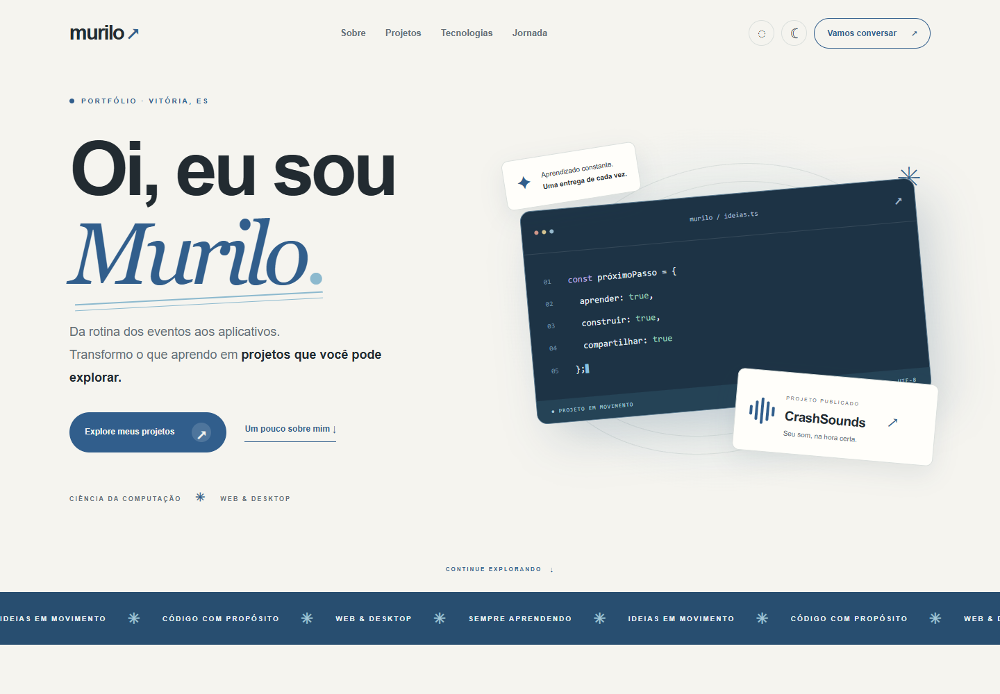

<!-- Visual animado recuperado do histórico do perfil; conteúdo atualizado preservado. -->

  

  

# Murilo Toledo

**Estudante de Ciência da Computação na FAESA · Vitória, ES · Buscando estágio em desenvolvimento de software**

Desenvolvo projetos web e desktop para praticar programação, persistência, testes e integração com recursos do sistema. Minha experiência em atendimento e eventos ajuda a transformar necessidades operacionais em funcionalidades.

[Portfólio](https://toled0o.github.io/Toled0o/) · [LinkedIn](https://www.linkedin.com/in/murilo-siqueira-toledo-157331413/) · [E-mail](mailto:murilosiqueiratoledo@gmail.com)

## Explore meu portfólio

  

  <a href="https://toled0o.github.io/Toled0o/"><strong>Abrir meu portfólio ↗</strong></a>
  · <a href="https://toled0o.github.io/Toled0o/#projetos">Explorar projetos</a>
  · <a href="https://toled0o.github.io/Toled0o/#contato">Conversar comigo</a>

No site: projetos com filtros, animações, tema claro e escuro e demonstração interativa.

  
  

## Projetos em destaque

### CrashSounds — soundboard open source para Windows

Aplicativo em **Python e PySide6** com biblioteca de sons, categorias, favoritos, atalhos globais e reprodução em fones e saída virtual. Inclui importação/exportação portátil e download de mídia por links públicos usando yt-dlp e FFmpeg.

**Versão pública de testes: 0.5.0.** Instalador Windows x64 e ZIP portátil disponíveis. O áudio começa desativado; nenhum driver é instalado pelo aplicativo. Hardware, latência e compatibilidade com sites exigem validação no ambiente de uso.

[Conhecer o projeto](https://github.com/Toled0o/CrashSounds) · [Baixar versão de testes](https://github.com/Toled0o/CrashSounds/releases/tag/v0.5.0)

### Painel de Gestão de Eventos — aplicação web

Projeto com **Next.js, React, TypeScript e SQLite** para agenda, eventos, equipe, fornecedores, checklists e financeiro por evento. Inclui acessos por token com permissões e relatórios pós-evento enviados pela equipe.

Testes de regras de negócio e permissões, preparação PostgreSQL/Prisma e implantação Docker. Em desenvolvimento e validação local; não apresentado como serviço homologado em produção. Repositório privado.

### Nexus PC — aplicativo desktop para Windows

Projeto com **Tauri, Rust e React** para acompanhar memória e processos, analisar temporários e gerenciar inicialização com restauração. Integra consultas do Microsoft Defender e abertura validada do Malwarebytes instalado.

Executável compilado e instalado localmente. Não incorpora o motor proprietário do Malwarebytes nem oferece equivalência antimalware certificada. Repositório privado.

## Tecnologias presentes nos projetos

| Área | Tecnologias |
| --- | --- |
| Linguagens | Python, TypeScript; Java na graduação; Rust no Nexus |
| Interfaces | React, Next.js, PySide6 |
| Dados | SQLite, JSON; preparação PostgreSQL/Prisma |
| Qualidade e ferramentas | Git, GitHub, testes automatizados, Playwright, Docker |

Meu foco é compreender as decisões técnicas, revisar o código e desenvolver autonomia. Utilizo ferramentas de IA como apoio ao desenvolvimento e à investigação de problemas.

## Formação e experiência

- **Ciência da Computação — FAESA:** graduação em andamento, 2º período em 2026.
- **Toledo Gastronomia — desde 2024:** atendimento, marketing e apoio à organização de eventos.
- **Idiomas:** português nativo, inglês A2 e espanhol básico.

## Fundamentos e estudos

[Projetos em Python](https://github.com/Toled0o/Projetos-python): gerenciador financeiro e analisador de notas, com funções, validação de entradas e persistência em arquivos.

## Contato

Busco estágio para contribuir com uma equipe e aprofundar desenvolvimento de software, testes e integração de sistemas.

[LinkedIn](https://www.linkedin.com/in/murilo-siqueira-toledo-157331413/) · [murilosiqueiratoledo@gmail.com](mailto:murilosiqueiratoledo@gmail.com)

